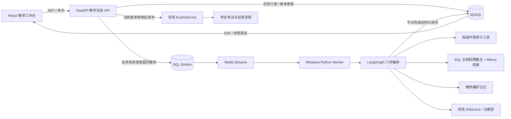

# 从错题统计到可审核的教学任务

这份文章记录当前实现，可用于技术博客初稿。真实模型效果和生产表现仍未测量，不能将独立测试结果换算成教学效果或线上可用性。

## 业务问题

教师已有历史考试和上传材料，但“看见薄弱点”与“准备下一堂课”之间仍需手工整理。新工作台把最近两次考试中的已批改作答汇总为薄弱知识点，检索本班级允许使用的教材，生成限时教案和定向练习，由教师编辑、审核后发布到既有考试模块。

这个业务有明确的人工责任边界：Agent 准备教学建议，教师决定题目能否进入学生课堂。生成成功、通过结构校验和教师审核是三种不同状态。

## 系统结构

## 为什么任务记录不放在 Web 进程内

LLM 请求可能超过普通 HTTP 请求时长，教师也可能关闭页面。任务创建和派发意图写入同一 SQL 事务，Worker 再向 Streams 派发；Redis 不可用时保留 outbox，而不是把任务标记为已经执行。

Streams 的投递是至少一次。Worker 在 MySQL 内认领任务并绑定随机 owner，持续续约。重复消息无法再次认领正在执行或已完成的任务。取消清除 owner，旧模型结果即使稍后返回也无法保存。失效 owner 的租约过期后，可以从最近成功的节点继续。

节点外部调用完成、SQL 检查点尚未提交时进程终止，重启后仍可能重复该调用并产生模型费用。当前保证业务状态和发布的幂等性，不保证第三方 API 调用恰好一次。

## Planning、Tool Use 和 Memory 的实际边界

LangGraph 控制 analyze、retrieve、plan、generate、validate、await_review 六步及校验修正循环。工具是固定的服务器函数，模型不能自行选择任意 URL、SQL 或班级 ID；班级和教师来自持久任务记录。统计工具读取当前班级学生的已批改作答，检索工具先查询 SQL 权限，再对向量搜索传递允许的文档 ID 集合。

Memory 只复用教师自己的 preference 和 teaching_style。旧 class_note 没有 class_id，当前不把这种记忆混入任务，以免跨班级观察进入本班教学。

生成采用严格 JSON 契约，只支持四选一题型。校验数量、时长、分数、答案枚举、重复题干、选项重复、真实引用 ID 和知识点覆盖。失败最多两轮自动修正，再进入等待补充状态。结构校验不能证明题目语言质量或教学合理性，因此仍需教师审核。

当前检查点采用应用层 SQL 业务状态，没有实现 LangGraph 原生 Checkpointer 或 interrupt/resume。节点检查点足以恢复当前单线流程，但如果将来需要子图、分支回溯、原生中断恢复或任意历史 replay，应新增经过验证的原生 Checkpointer，而不是继续堆叠 completed 标记。

## 审核和发布如何绑定

教师保存内容后增加 artifact_version，清空 approved_version。发布要求当前版本已经审核，任务行在 MySQL 中加锁。同一事务创建并发布 `teacher_exam`、保存其 ID，再标记任务 published；重复请求读取同一个 ID。

这种方式复用原有学生可见的试卷和批改业务，减少了重复建设一套“Agent 作业系统”的成本。原生小程序不需要学习新的任务 API。

## 来源可信与答案正确是两类指标

检索命中必须能在当前允许访问的文档原文中找到。引用保存文档 ID、内容 SHA-256、片段及已知页码，旧解析没有分页信息时显示未知页码。这能证明来源可追踪，不能证明语义相关性。

固定检索集包含无资料和越权问题。越权应被权限边界拒绝；无资料问题仍可能召回语义相近但无关的段落，必须通过真实评测建立拒答阈值。当前没有编造命中率、教师采纳率或“优化提升百分比”。模型追踪记录供应商返回的 token usage 和耗时，费用缺失时保留 null。

## 本轮遇到的工程问题

新增 LangGraph 导致 Pydantic 和 AnyIO 依赖升级，原 FastAPI 0.104.1 与 AnyIO 4 冲突。将 FastAPI 固定到兼容版本后，运行旧回归和应用导入，再加入新工作流测试。

浏览器测试发现 Vite 使用 `/Elearning/` 前缀，而 Router 没有 basename。直接访问任务 URL 会被通配路由送走。修正为 Vite BASE_URL 后，重新验证直接访问、发布后刷新和平板布局。

主应用旧迁移链存在缺失的 revision。演示库采用独立冻结链，从仓库根目录用 `server/database/alembic-agent.ini` 运行。迁移目录已移入 `server/database/`，Alembic CLI 可以从 `server/` 正常导入安装包。在线迁移仍需用独立数据库验收。

## 面试演示建议：约6分钟

| 时间 | 操作和需要展示的证据 |
| --- | --- |
| 0:00–0:45 | 展示真实环境检查、合成班级与历史考试，说明数据脱敏方式 |
| 0:45–1:45 | 创建20分钟、10题任务，展示步骤状态和真实错题统计 |
| 1:45–2:45 | 打开教材引用，核对页码、原文和版本 |
| 2:45–3:45 | 修订一道题，保存后展示审核版本失效，再重新审核 |
| 3:45–4:30 | 发布并进入学生考试入口，重复发布确认同一试卷 |
| 4:30–5:15 | 演示无权班级被拒绝和任务断点恢复（真实联调通过后录制） |
| 5:15–6:00 | 展示评测样本、真实耗时/token、仍未解决的限制 |

这张表是录屏脚本，当前没有声称已经录制真实演示视频。录屏前应先按启动文档完成 MySQL、Redis、Milvus 和模型链路验收。
