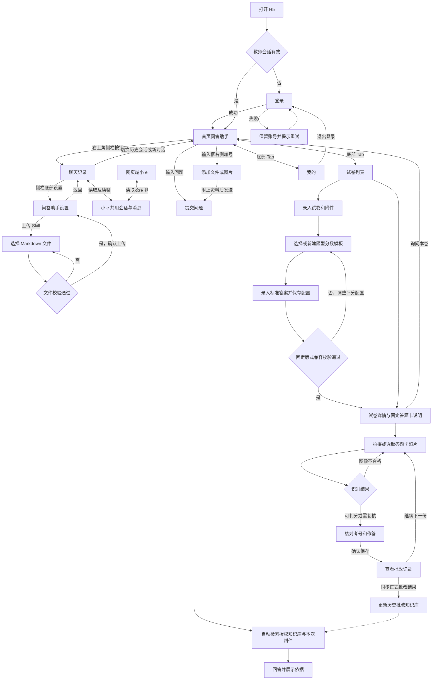

# 批卷 H5 端产品需求文档

| 项目 | 内容 |
| --- | --- |
| 所属项目 | Elearning |
| 文档版本 | v0.6 · 评审稿 |
| 更新日期 | 2026-11-23 |
| 适用对象 | 产品、设计、研发、测试 |

【本次更新】H5 首页问答助手与网页端小 e 是同一功能的两个入口，共用会话、消息历史和对话上下文。

本版明确固定答题卡的取景、手写准考证号、卡面题位及同卷成绩唯一性。[固定答题卡需求变更](../changes/2026-11-23-固定答题卡扫描与准考证号.md)

## 1. 产品定位与目标

教师通过手机浏览器登录 Elearning，完成录入试卷、配置成绩规则、拍摄纸质答题卡、确认成绩和查看记录。批卷结束后，教师可以在首页直接询问哪些题失分集中、应优先讲评什么，并查看回答依据。

| 场景 | 教师任务 | 完成标准 |
| --- | --- | --- |
| 考试准备 | 上传试卷原件，选用兼容固定答题卡的评分模板，为本卷录入标准答案 | 配置通过校验后可使用指定的固定答题卡批卷 |
| 考后批阅 | 连续拍摄答题卡，核查识别结果和考号，确认成绩 | 每份确认成绩可查，每份异常卡能继续处理，重复操作只产生一条有效成绩 |
| 讲评备课 | 查看易错题和典型错误选项，向助手询问讲评顺序 | 回答提供试卷范围、样本量和数据依据，教师可返回记录核对 |

上线后衡量从添加试卷到首份成绩确认的耗时、答题卡首次识别通过率、复核比例及助手回答的证据覆盖率。基线采用试点实测，目标和取样方法见第 11 节。

## 2. 首版范围与导航

**首版范围**为教师移动浏览器上的单选题批卷和历史批改知识问答。单选作为评审假设，每题一个标准答案，全对得本题满分。多选、主观题、部分给分、仅凭原件自动生成评分规则、任意外部答题卡识别、离线批改和协作阅卷进入后续评估。学生开放交卷、班级管理、注册和找回密码沿用 Elearning 的对应入口及流程。

| 入口 | P0 首版能力 | P1 后续评估 |
| --- | --- | --- |
| 登录 | 使用已有教师账号登录、权限校验、会话恢复 | 其他登录方式 |
| 首页 | 网页端小 e 的手机入口，支持跨端续聊、历史批改检索、文件及图片问答和来源跳转。右侧栏支持历史会话、新对话及问答助手设置 | 定时生成跨卷趋势报告、会话搜索与归档 |
| 试卷 | 试卷列表与详情、新建与草稿、原件上传、题型分数模板、逐题答案、固定答题卡说明、相机扫描、复核、批改记录 | 成绩导出、批量复核 |
| 我的 | 查看个人资料、退出登录 | 资料编辑 |

登录成功默认打开「首页」。一级页面底部固定显示「首页 / 试卷 / 我的」。试卷详情、模板编辑、相机、复核和问答助手设置等二级页面使用返回导航，问答助手设置页隐藏底部 Tab。从试卷详情选「询问本卷」时，将卷名带入问题草稿，教师可继续编辑或发送。切换一级 Tab 后保留列表筛选和问答上下文。



## 3. 现状与复用边界

下表依据当前仓库源码判断复用点。第 4 至 11 节描述 H5 目标行为和首版评审口径。

| 能力 | 当前源码可见能力 | H5 需求 |
| --- | --- | --- |
| 教师登录和资料 | 教师登录与个人资料查询 | 提供 H5 登录、会话恢复和触屏体验。[认证路由](../../server/app/api/v1/auth.py) |
| 试卷和模板 | 教师试卷、答题卡模板、打印配置与逐题评分 | 核实模板结构映射，保存附件、每卷评分配置和版本。[试卷模型](../../server/app/models/exam_models.py) · [试卷路由](../../server/app/api/v1/exam.py) |
| 答题卡扫描 | Web 管理端可生成限时扫码会话，教师凭证也可访问 OMR 扫描接口。现有扫描会直接评分并写入成绩，匹配到同一考生时可能覆盖旧成绩 | 保留原扫码入口。H5 需能暂存识别预览，并经教师确认、查重后写入成绩。[现有批卷页](../../client/src/pages/ExamGrade/index.tsx) · [扫卷路由](../../server/app/api/v1/exam.py) · [扫码优化记录](../../.harness/changes/answer-sheet-scan-optimization-20260921/summary.md) |
| 批改结果与助手 | 已有成绩、扫描记录、逐题评分与教师助手会话入口 | 复用可信数据与会话能力，补齐历史批改知识库、有效成绩统计和来源跳转。[扫描记录模型](../../server/app/models/scan_models.py) · [逐题评分](../../server/app/services/paper_grading.py) · [助手路由](../../server/app/api/v1/teaching_assistant.py) |
| 会话、附件和 Skill | 网页端小 e 已使用教师助手服务创建会话、读取消息历史和发起对话。教师助手已有附件上传入口，现有 Markdown Skill 类型为 PPT 和出卷 | H5 接入同一教师助手服务和会话记录，补齐批改知识库检索和来源引用，并确认问答 Skill 的生效规则。[网页端小 e](../../client/src/pages/TeachingAssistant/index.tsx) · [助手路由](../../server/app/api/v1/teaching_assistant.py) · [Skill 路由](../../server/app/api/v1/agent_skill.py) |

## 4. 登录与我的

登录页展示 Elearning 标识、账号、密码和「登录」按钮，移除「教师登录」页面标题。账号权限校验沿用已有教师认证。

- 使用现有教师账号和密码，账号字段遵循项目认证契约。登录页提供密码显隐和提交状态，提交时防止重复请求。账号或密码不匹配时统一提示「账号或密码有误，请重试」。网络失败时保留账号并允许重试。非教师身份提示「请使用教师账号登录」。
- 未登录打开受保护页面时跳转登录。登录成功后可回到原有权访问的页面。会话失效时暂停当前操作，重新登录后返回原页面。遇到成绩提交结果未知时先查询状态再恢复操作。登录页和普通登录会话均使用项目已有账号权限，原扫码会话的授权范围仅限原扫描业务。
- 「我的」展示当前教师的头像或占位图、姓名或昵称、账号标识、教师身份。空字段显示「未设置」，获取失败可重试。若展示邮箱或手机号，默认脱敏。
- 点击「退出登录」显示确认弹窗。确认后结束 H5 会话、清除该账号的本地临时文件引用和页面缓存、关闭相机并返回登录页。再次打开上一页时要求登录。已保存的试卷、复核记录和成绩可在下次登录后继续查看。

## 5. 试卷与模板

### 5.1 试卷列表与详情

试卷列表按最近更新倒序，支持按名称搜索和筛选「草稿 / 可批改 / 批改中 / 已完成」。每行显示标题、班级或「未关联班级」、状态、已确认份数和近一次更新时间。空列表提供「添加试卷」，无搜索结果支持清除条件，加载失败有重试入口。详情展示附件、模板名称与应用版本、逐题答案、答题卡、批改统计和记录入口。草稿主操作为「继续编辑」，可批改及批改中的试卷主操作为「开始批卷」。

| 状态 | 进入条件 | 可执行操作 |
| --- | --- | --- |
| 草稿 | 新建后保存，配置可暂缺 | 继续编辑，补齐后设为可批改 |
| 可批改 | 试卷原件、模板和逐题答案齐全，且与已配置的固定答题卡兼容 | 查看资料和固定答题卡说明，开始批卷。更新配置按第 5.4 节处理 |
| 批改中 | 第一次保存待复核记录或确认成绩 | 扫描、复核、查看记录。满足结束条件时可「结束批卷」 |
| 已完成 | 教师主动结束，至少有一条确认成绩且待复核队列为空 | 查看记录、询问本卷。需要补批时可「继续批卷」返回批改中 |

开始批卷和结束批卷是纸质阅卷操作。发布线上考试仍走 Elearning 的发卷流程。没有班级或花名册时，已确认份数按有效考号统计，界面按份数展示。没有可靠应批人数时只展示已确认与待复核份数。

### 5.2 添加试卷和上传原件

1. 填写名称，可关联本人有权限的班级并填写备注。已有成绩或待复核记录时锁定班级，避免已录成绩归到新班级。
2. 上传至少一份试卷原件。建议首版支持 PDF、DOCX、JPEG、PNG、WebP，可混合添加。展示文件名、类型、顺序和上传状态，提供移除、重试、图片预览与下载入口。文档预览不可用时提供下载。
3. 选择老师已有模板，或在当前流程创建模板。创建成功后回到本卷并自动选中该模板，已录的试卷资料和附件继续保留。
4. 逐题录入标准答案，页面显示已配置 `X / N`、未完成题号和满分。支持「保存草稿」，完成时点击「保存试卷」。若当前评分配置与固定答题卡不兼容，保留草稿，指出冲突的题号或选项，并引导修改。部分附件上传失败时保留成功附件和表单。

### 5.3 题型分数模板

模板由教师保存和复用，字段包括名称、题量、逐题选项数量和逐题分值，首版题型固定为单选。新增时可设置统一选项数量和分值后批量应用，再逐题覆盖；题号从 1 连续生成，选项按 A 起顺序生成，模板满分为各题分值之和。缩减题量、覆盖已有逐题设置时显示影响并确认。模板列表展示名称、题量、总分、更新时间，支持创建、查看、编辑和停用。创建同名模板时提示改名或打开已有模板编辑。

每份试卷一次应用一个模板，将模板版本、题号、每题选项及分值保存为本卷的独立配置。模板内只维护评分结构；标准答案在各试卷分别设置。更新或停用模板后，已应用该模板的试卷继续使用已保存版本。新建试卷的选择器仅展示可用模板。

### 5.4 本卷答案与固定版式答题卡【本次更新】

- 标准答案必填，每题可从本题选项中选择一个。分值与满分来自应用时的模板。更换模板时展示新旧题量、满分和受影响题号，经确认后清空本卷标准答案，避免旧答案被套入不同题目，试卷资料继续保留。
- 首版扫描使用需求方统一提供的固定版式答题卡。以正式样张配置填涂区、题号到纸面位置的映射、可用选项和样张实际具备的身份识别区。H5 提供固定版式说明，正式原版可用后提供只读预览。创建试卷时无需上传或生成答题卡。
- 每份试卷绑定一个已登记的卡面版本。本卷评分项显式绑定卡面印刷题号，允许跳号；通用评分模板仍可按顺序编辑。未绑定的题位及非选择题区域不计入自动批改。版式、题位、选项及分值随本卷配置保存。
- 题型分数模板负责本卷题号、选项数量和分值，标准答案按卷配置。系统校验每道题及其选项能否映射到固定卡上的对应位置。允许使用部分题位时，未配置题位不计分。固定版式尚未配置或模板不兼容时，禁用批卷入口并说明原因。
- 首条待复核记录或正式成绩保存前，可以更新答案和模板。更新后旧识别预览失效，并重新校验与固定版式的兼容性。出现待复核记录后暂锁评分配置，教师可在尚无正式成绩时处理或明确放弃待复核记录后解锁。首条正式成绩保存后锁定模板、答案和识别配置版本。需要修正评分口径时，首版支持复制为新卷并重新批改，保留原卷和记录。

## 6. 手机扫描与复核

### 6.1 拍摄与识别

- 点击「开始批卷」显示本卷和班级，教师选择「打开相机」时才请求摄像头权限，优先调用后置摄像头。取景页提示将整卡和定位点纳入画面，检查模糊、反光、裁切及亮度。拍摄后提供预览、「重拍」与「识别答题卡」。首版逐张处理，确认或保存待复核后可一键「扫下一份」。
- 生产及手机验收环境使用 HTTPS。权限被拒、请求无响应、设备占用或浏览器不提供实时取景时，可按提示重试或用系统相机、相册选择单张照片。替代入口执行同样的类型、质量和版本校验。离开扫描页、切后台或退出登录时释放摄像头，回到扫描页按需重新打开。[摄像头 API 文档](https://developer.mozilla.org/en-US/docs/Web/API/MediaDevices/getUserMedia) · [文件输入拍摄属性](https://developer.mozilla.org/en-US/docs/Web/HTML/Reference/Attributes/capture)
- 照片按配置的固定版式做 OMR（光学标记识别），输出逐题原始填涂、可读取的考号、可疑项及识别状态。版式不匹配时提示换用指定答题卡，定位失败或严重模糊时提示重拍。低置信、重涂、多涂或考号可疑项进入复核。多份试卷共用同一版式时，教师须先进入对应的试卷，扫描结果按该卷标准答案评分。若卡面缺少可区分试卷的标识，由教师在确认前核对归属。
- 取景框按绑定版式引导老师完整拍入姓名、准考证号格、参与评分的选择题填涂区及定位标记。如果定位依赖整页角标，取景框覆盖整页。相机与相册使用相同的校验规则。系统先定位并矫正照片，再在标准坐标中读取准考证号和填涂；关键区域裁切或严重反光时提示重拍。
- 手写准考证号按该版式的格数逐格从左到右读取，每格一个数字，拼接为定长字符串并保留前导零。空格、难辨、格外续写或条码与格内结果不一致时进入待复核。格外字符或条码不得自动补写到考号。人工修正和正式确认均按相同的格数及数字规则校验。

```text
+--------------------------------+
| 返回        本卷名称 · 连续批卷 |
| 当前班级 / 布局版本             |
| +----------------------------+ |
| |                            | |
| |    取景框与答题卡定位角      | |
| |                            | |
| +----------------------------+ |
| 请将答题卡四角完整放入取景框    |
| 选取照片         拍照          |
| 已确认 12 份 · 待复核 2 份      |
+--------------------------------+
```

### 6.2 判分、考号与提交

| 项目 | 首版规则 |
| --- | --- |
| 判分 | 按本卷保存的标准答案和分值逐题比对。正确得该题满分，确定的错选、空白得 0 分。超出选项范围、低置信、多涂或疑似擦改须人工核对；确认学生确实多涂时记为无效填涂得 0 分。总分由服务端对逐题分求和。 |
| 考号 | 有班级时，按校验后的准考证号匹配本卷授权班级的花名册。缺号、未匹配、匹配多条或姓名疑似不一致时进入待复核；选择学生仍须核对完整、有效的考号。无班级时可按同一规则人工确认考号。姓名作为核对信息，准考证号以定长字符串保存。 |
| 确认 | 结果页展示答题卡照片、考号及匹配对象、预计得分、满分和逐题对照。教师可基于原图修正学生作答，页面更新预览分数。可疑项全部处理且身份明确后才能「确认成绩」。可先「保存待复核」或返回重拍。 |
| 幂等 | 双击、弱网重试、超时后重新登录等对同一提交的重试应返回同一结果。若状态未知，先查询原操作结果，保留上下文并允许从详情或记录继续。 |
| 重复与更正 | 固定手写卡统一按「试卷 ID + 准考证号」保留一条有效成绩，有班级和无班级使用同一规则；学生账号关联用于花名册。识别到重复时展示已有成绩、确认时间和新结果，提供「保留原成绩」和「确认重批」。重批保留历史版本，统计采用新有效版本。并发确认由服务端保证唯一性。 |

### 6.3 批改记录

从试卷详情进入「批改记录」，可按考号或学生姓名查找，按状态筛选，默认按最近更新时间倒序。列表展示考号或姓名、来源、分数或待复核提示、状态与时间。详情展示照片、逐题原始识别和教师确认值、标准答案、得分及修正历史。教师可从待复核详情继续处理。

| 状态 | 页面反馈与下一步 | 统计口径 |
| --- | --- | --- |
| 识别中 | 显示当前处理进度，等待或返回试卷 | 计入处理过程 |
| 识别失败 | 显示失败原因，提供重拍或重新上传。历史中可展开该次尝试 | 计入失败尝试 |
| 待复核 | 展示待处理题和身份问题，提供复核或放弃 | 单独展示待复核份数 |
| 已确认 | 展示成绩及逐题结果，允许按重批规则更正 | 每个有效学生或独立考号计一份 |
| 已被替换 / 已放弃 | 保留记录、变更时间及原因，供追溯 | 计入历史操作 |

试卷成绩汇总和问答只读取当前有效的已确认记录。成绩、统计和历史修正需要一致。若已有错题本链路接入本卷，更正成绩时同步修正对应错题，避免错误记录重复累计。历史 Web 或小程序试卷在配置及版式兼容后即可在 H5 开始批改。共享同一试卷的写入入口需遵循该卷的成绩确认和重批规则，避免旧入口覆盖 H5 已确认成绩。

## 7. 首页问答助手

### 7.1 历史批改知识问答

- 首页顶栏仅保留右侧「打开聊天记录」图标，提问无需选择试卷。助手根据问题中的卷名、题号、时间、知识点、会话上下文或附件线索，在当前教师有权访问的历史批改知识库中自动定位相关资料，可检索单卷或多卷。匹配存在歧义时，通过对话询问必要线索。未匹配到依据时提示补充信息或上传资料。
- 知识库纳入有权限的历史试卷及后续确认的批改结果。每道题关联试卷、题号、可取得的题干和选项、标准答案、学生作答、对错及得分。历史数据需补录索引，新增确认与重批更新同一记录的有效版本。待复核、作废或已被替换的成绩不进入正式统计。缺失题干或答案时展示资料缺失。
- 支持题目正确率、典型错选、跨卷比较和讲评建议。推荐问题包括「最近哪些题最容易错？」和「10 月随堂测第 8 题错在哪？」。
- 系统根据正式成绩计算统计，模型使用有权限的统计结果组织解释和建议。均分为有效记录总得分除以有效份数。单题正确率为该题答对份数除以该卷有效份数，已确认的空白和无效填涂计入分母。错选分布单独标识空白及无效填涂，展示计数及分母。分析中的百分比前台显示到一位小数，排序使用原始比率，同率按题号升序。
- 回答展示命中的试卷及题号。统计结论同时说明范围、有效样本数和统计时点，并可跳转到批改记录或题目统计。无知识库资料时仍可上传文件或图片提问。网络或模型失败时保留原问题和附件并提供重试。
- 示例基于合成数据。「本卷已有 24 份确认成绩。第 8 题 9 份答对，正确率 37.5%。错选集中在 B（10 份），建议先让学生解释选 B 的依据，再比较 B 与标准选项的差异。」同时给出第 8 题统计入口。缺少题干时，回答明确说明建议依据为选项分布。

### 7.2 聊天记录侧栏【本次更新】

- 点击右上角图标，从右侧滑入「聊天记录」侧栏。顶部可关闭或选择「新对话」，中间按最近更新排序展示会话标题与更新时间，并标记当前会话。列表可滚动，底部固定「问答助手设置」。
- 点击历史会话时恢复授权范围内的消息、附件和可访问的来源。新对话恢复推荐问题，后续提问重新检索相关资料。访问已失效或撤权的来源时提示不可用。切换会话后，进行中的响应仍归入原会话。
- 无历史记录时展示「暂无聊天记录」，可直接新建对话。读取失败时可在侧栏重试。关闭侧栏保留当前对话，键盘焦点回到右上角入口。动效按设计稿执行，并尊重系统减少动态效果的设置。

### 7.3 问答助手设置与 Skill 上传【本次更新】

- 从侧栏底部进入「问答助手设置」。页面显示当前教师的 Skill 列表，每项展示技能名称和原文件名。设置页提供「上传 Skill」，无记录时显示「暂无 Skill」。返回时重新打开聊天侧栏并恢复进入前的会话。
- 点击「上传 Skill」打开底部面板。一次选择一个 Markdown 文件，支持 `.md` 和 `.markdown`。选中文件后显示文件名，可更换或取消。校验通过后允许确认上传，提交期间防止重复点击。成功后关闭面板、更新列表并提示结果。
- 格式错误、文件为空、无法解析、缺少 `name` 或存在同名 Skill 时，在面板内显示对应原因并允许更换文件。网络失败时保留已选文件并提供重试。取消上传后返回设置页。文件校验和教师归属由服务端确认。
- Skill 在问答中的类型、绑定范围及启用规则见第 11 节。上传成功反馈表示文件已保存到当前教师的 Skill 列表，生效状态按最终规则展示。[H5 设计稿](../design/H5design.pen) · [可点击预览](../design/H5design/motion-preview.html)

### 7.4 文件和图片问答【本次更新】

- 输入框右侧提供「+」，与发送按钮分开。点击后从底部面板选择「上传文件」或「上传图片」。选中后展示文件名或图片缩略图，可逐个移除，发送时与问题一起处理。
- 上传和解析过程显示状态。格式错误、文件超限、无法读取或解析失败时提示原因，支持重选和重试并保留问题草稿。助手可结合本次附件和已授权的批改知识库回答，并区分附件依据与历史批改依据。问答附件只在所属会话内使用。

### 7.5 与网页端小 e 共用会话【本次更新】

- H5 首页问答助手是网页端小 e 的移动入口。同一教师账号在任一端打开历史记录，都读取同一套服务端会话。已有网页端会话可在 H5 打开并继续，任一端新建的会话也会出现在另一端的列表里。
- 两端通过同一会话标识续聊，共用已保存的消息、对话上下文、可用附件和来源引用。教师在一端发送消息后，另一端打开或刷新同一会话即可查看，并可在此基础上追问。新建对话使用独立上下文。未发送草稿属于当前端。
- 任一端对已保存会话的变更反映到同一份记录。两端同时续聊时，服务端按会话顺序保存消息，重试避免重复写入。会话、附件和来源均按当前权限校验。

## 8. 数据与交互约束

下表的 H5 参数为评审建议。现有扫描上传阈值来自仓库源码。题量、可用选项和考号规则以固定版式样张及扫描验收为准。

| 对象 | 字段与约束 |
| --- | --- |
| 试卷 | 名称去除首尾空白后 1–100 字，备注可选且最多 200 字，班级可选，附件至少 1 个，应用一个模板版本。 |
| 试卷原件 | 建议最多 10 个文件，单文件不超过 20 MiB、合计不超过 50 MiB。校验扩展名、实际文件格式及内容损坏，失败提示对应文件及可操作原因。 |
| 题型分数模板 | 名称 1–50 字，同教师下唯一。题量和逐题选项数量受固定答题卡可用题位及选项限制。建议每题 1–100 整数分，支持逐题修改。 |
| 单题配置 | 本卷按实际卡面题号保存，题号在卷内唯一，可跳号。标准答案须来自该题位的可用选项；按保存的逐题分值计算满分。 |
| 答题卡照片 | 单张 JPEG、PNG 或 WebP，沿用现有扫描上限 12 MiB、4,000 万像素。其他格式由可用的拍照或选图通道转换，转换失败时提示可接受的格式。 |
| 扫描和成绩记录 | 保存试卷标识、配置版本、提交标识、来源、考号、匹配身份、状态、时间、逐题结果及审核者。修正记录保留前后值与原因。记录引用的长整型 ID 在浏览器侧按字符串处理。 |
| 提问 | 非空文本，建议单条不超过 1,000 字，可附文件或图片。结果归入发起请求的会话，消息可引用多份试卷或附件。 |
| 问答会话 | 复用小 e 的会话标识和服务端记录，保存教师归属、标题、更新时间、消息、附件和证据引用。H5 与网页端按同一会话读取上下文，并分别校验会话及每条来源的当前权限。 |
| 问答附件 | 建议首版支持 PDF、DOCX、TXT、JPEG、PNG 和 WebP。类型、单文件大小及每次提交的数量按解析能力确认。附件仅对所属会话授权访问。 |
| 【本次更新】问答 Skill | 保存教师归属、技能名称和原文件名。支持单个非空 Markdown 文件，须可解析并包含有效的 `name`。以当前教师的问答 Skill 范围判定同名，拒绝静默覆盖。单文件大小上限待确认。 |

离开未保存的编辑页时提供「继续编辑 / 保存草稿 / 放弃修改」。网络失败提示应保留已填内容和可重试任务。明确区分「还没有批改记录」与「记录加载失败」；判断考号有歧义时用「未匹配到学生，请核对考号」指引。登录、上传、扫描和保存均显示执行状态，状态信息用文字和图标同时表达。

## 9. 权限、安全与移动端体验

- 服务端逐次校验教师登录状态和试卷、模板、班级、成绩、图片及问答的访问权限。试卷原件和答题卡照片采用带鉴权访问，附件下载与预览遵从一致的授权规则。登录、上传错误和日志避免写入凭据、完整考号、学生姓名与图片内容。问答向模型传递当前问题所需的最小授权数据，首版分析问题使用去标识的聚合结果。
- 【本次更新】历史会话、消息、试卷范围及 Skill 列表和上传均以当前教师授权为准。Skill 按文本配置解析，服务端校验文件类型、实际内容、文件名和大小。问答数据的授权继续由服务端执行。
- 使用稳定的横竖屏布局和触控目标；试卷长列表滚动时保留必要操作，底部栏、输入框和键盘需避开系统安全区。摄像头中断、手机来电或切后台后可以恢复操作，避免重复保存成绩。验收优先覆盖 iOS Safari、Android Chrome，微信内置浏览器根据实测确定实时相机或替代入口，支持版本见第 11 节。
- 文件、原图和成绩分别应用项目数据保留要求。真实试点前明确保存时长、授权下载和删除流程。测试样本采用合成或脱敏答题卡。

## 10. 验收标准

| 编号 | 验收场景 | 通过条件 |
| --- | --- | --- |
| AT-01 | 教师登录、受保护页面、资料与退出 | 教师能打开三个一级 Tab 并查看资料。游客和非教师无法读写数据。过期会话可重新登录后恢复目标页，退出后浏览器返回无法读取原账号数据。 |
| AT-02 | 添加试卷与上传 | 合成 DOCX、PDF 和图片可添加到同一卷。坏文件和超限文件逐个提示。网络中断后重试保留其他已上传原件，草稿重开后仍可编辑。 |
| AT-03 | 固定答题卡与独立答案 | 两份试卷复用兼容的评分模板和同一固定版式，分别录入不同标准答案。使用相同填涂结果分别批改，按各卷标准答案得分。更新或停用原模板后，两卷仍按各自已保存的配置批改。 |
| AT-04 | 固定版式校验 | 缺答案、题位或选项超出固定卡支持范围、版式尚未配置时无法开始批卷。使用需求方提供的样张及填写样本验证题号、选项、考号与得分对应。异版卡提示换卡，无法确认归属的同版卡由教师核对后再确认。 |
| AT-05 | 手机相机与替代入口 | iOS 和 Android 真机能在 HTTPS 环境开启相机、拍照和批改。拒绝授权、切后台、模糊或裁切时提示清楚，可重拍或选图，离开后摄像头释放。 |
| AT-06 | 识别异常与复核 | 空白题 0 分，疑难填涂和考号匹配问题能保存待复核，修正后总分和明细一致。班级缺失时可录入带前导零的考号完成批卷，错误班级匹配请求被拒绝。 |
| AT-07 | 重复与并发 | 同一请求多次提交只产生一条有效成绩。两台手机并发确认同一考号时只产生一条有效成绩，后到者可核对已保存结果。重批前须明确确认，历史可查，记录和问答按最新有效成绩统计。 |
| AT-08 | 记录与结束 | 列表筛选、确认和待复核数量准确。待复核队列未清空时提示先处理。结束后可查历史，再次开始可补批，前后状态正确。 |
| AT-09 | 历史知识库和问答准确性 | 准备至少两份试卷的题目、答案和历史成绩。无需选卷即可通过问题定位单卷或跨卷统计，来源能打开。重批后排除被替换的结果。题号歧义时追问，缺少资料时明确提示。 |
| AT-10 | 数据隔离与跨端回归 | 教师 A 无法通过试卷、附件、学生和问答请求访问教师 B 的授权数据。旧二维码入口按原有授权工作。合格历史成绩可在 H5 正确展示，无法映射到 H5 评分或布局的旧卷禁用重新扫描并指引到原入口。共享试卷上的 H5 已确认成绩只能通过有记录的重批更新。 |
| AT-11 | 首页侧栏与会话切换 | 首页直接提问，右上角侧栏可展开和关闭。切换会话恢复原消息及可访问的来源。新对话可从全库检索授权资料，旧会话继续保留。其他教师的数据无法访问。 |
| AT-12 | 【本次更新】问答助手设置 | 点击侧栏底部设置进入独立页面，可查看技能名称和文件名或空态。返回后重新打开侧栏，保留进入前的会话。 |
| AT-13 | 【本次更新】Skill 上传与校验 | 合法的 `.md` 和 `.markdown` 文件可上传，成功后列表更新。格式错误、空文件、缺少 `name`、同名或超限文件有明确提示。网络中断后可重试，也可更换文件或取消上传。重复点击仅保存一条记录。 |
| AT-14 | 登录标题和附件问答 | 登录页只显示品牌、账号密码表单及登录操作。首页输入框右侧「+」可选择文件和图片，选中后可移除，随问题发送后能引用附件。无历史资料时可基于附件提问，上传或解析失败时可重试并保留草稿。 |
| AT-15 | 小 e 跨端历史与续聊 | 同一教师先在网页端小 e 发出带明确题目线索的问题，再到 H5 打开同一历史会话，用「那道题」追问时可继承上下文。随后返回网页端刷新，能看到 H5 的追问和回复，并继续对话。H5 新建会话也能在网页端打开。两端读取同一记录，其他教师无法访问。 |
| AT-16 | 固定手写卡扫描 | 同版空卡和实拍卡可完成定位矫正，验证侧拍、倒转、裁切、反光和异版提示。跳号题与不同选项组按印刷题号评分。验证前导零、格数不符、格外续写、模糊单格和条码冲突。分别验证有班和无班的同卷同号重批，以及跨卷同号独立。 |

## 11. 发布前待确认项

正式发放版式仍待确认。现场样图与电子参考图的姓名、考号格、题组布局和定位标记不同，不能共用坐标。正式登记需要同版空白原件、脱敏填写样张、准考证号格数和条码规则，并确认可能存在的其他页或卷型是否纳入扫描。

以下首版假设用于评审、原型和估算。真机、纸样和数据验收后记录最终口径。

| 议题 | 文档采用的评审假设 | 确认依据 |
| --- | --- | --- |
| 题型与容量 | 单选、整数分。题量、选项数量及部分题位用法以需求方固定样张为准 | 用样张核对题号、各题选项、考号和同版不同试卷的评分情况。 |
| 答题卡版式 | 等待需求方提供空白原版及填写样本。题区、定位标记、考号区和识别配置版本随样本确认 | 使用空白、正常填涂、重涂或未填等样本验证拍摄、识别、校验和复核。 |
| 批卷确认方式 | 每份先预览再由教师确认，允许先保存待复核；班级可选 | 试点观察连续批卷耗时、重复考号比例及教师复核负担，检查现有扫描入库行为能否支持该流程。 |
| 附件与真实设备 | 支持第 8 节的文件类型，微信内置浏览器按实测提供取景或选图 | 验收设备、浏览器版本、系统权限及文档预览能力。 |
| 历史兼容与数据保存 | 优先复用已有试卷和成绩。旧卷的可批改范围、图片和资料保留时长待定 | 使用脱敏的 Web、小程序历史试卷核对状态、身份和旧答题卡坐标，确认数据保留口径。 |
| 【本次更新】问答 Skill 生效 | 首版设置覆盖上传和列表。问答 Skill 的独立类型或可复用映射、启用时机、多个 Skill 的使用规则和文件大小上限待定 | 结合现有 PPT 与出卷技能，确认问答技能如何保存、何时生效及其适用范围。 |
| 历史入库和问答附件 | 历史数据补录范围、索引更新时限、附件的格式与大小及图片文字提取能力待确认 | 用脱敏历史试卷和问答附件核对题干与答案完整度、重批后更新及文件解析效果。 |
| 上线度量 | 分别统计标准样本和真实拍摄样本的首次通过率（首次识别成功且无需复核的卡数 ÷ 首次提交的卡数）、中位确认耗时（拍摄提交至确认成绩）、复核比例（进入人工复核的卡数 ÷ 已提交卡数）、助手证据覆盖率（有可核对来源的统计回答数 ÷ 统计回答总数） | 产品、研发和测试在试点前确定样本量与目标值，按人工标注核对识别结果和问答数据，按实测确定首版支持清单。 |
